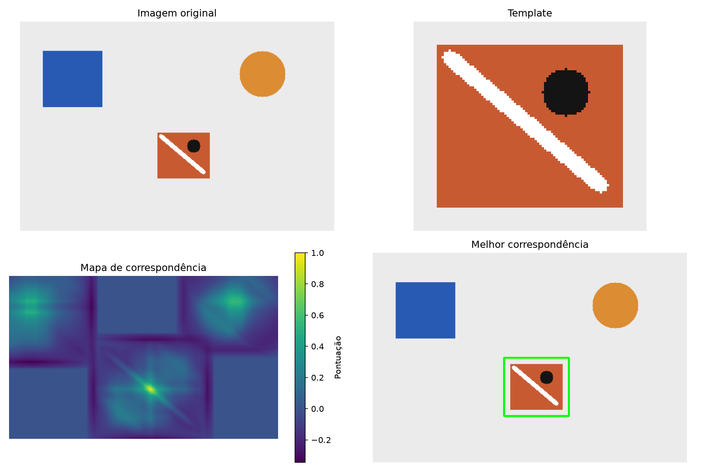

# Template Matching — Computação Visual

Tutorial teórico e prático da disciplina de **Computação Visual**, da **Universidade Presbiteriana Mackenzie** (Opção 2). O projeto explica e implementa a localização de um recorte de referência dentro de uma imagem maior, com Python, OpenCV, NumPy, Matplotlib e Jupyter.

Comece pelo [tutorial com fundamentação teórica e exemplos executáveis](Tutorial_Template_Matching.ipynb). Depois, continue nos [experimentos e análises de Matheus](Experimentos_Template_Matching_Matheus.ipynb).

## Sobre o Template Matching

O template é uma imagem de referência do padrão procurado. Uma janela do mesmo tamanho percorre a imagem de entrada e recebe uma pontuação em cada posição válida. O mapa resultante permite selecionar a melhor correspondência: o mínimo nos métodos SQDIFF e o máximo nos métodos de correlação. Essa busca identifica semelhança visual, sem reconhecer automaticamente uma categoria semântica.

Um limiar decide se a melhor resposta é aceita como detecção. A decisão é heurística: encontrar um extremo no mapa não garante que o objeto esteja presente.



## Estrutura do projeto

```text
template_matching/
├── README.md
├── requirements.txt
├── template_matching.py
├── Tutorial_Template_Matching.ipynb
├── Experimentos_Template_Matching_Matheus.ipynb
├── image2.jpg
└── exemplo/
    ├── imagem.png
    ├── template.png
    ├── template_hamster.png
    └── resultado.png
```

- `Tutorial_Template_Matching.ipynb`: introdução, teoria, fórmulas, exemplos visuais e ligação com a implementação e os experimentos.
- `template_matching.py`: implementação de João; leitura, conversão para cinza, matching, seleção, limiar e visualização, com interface de linha de comando.
- `Experimentos_Template_Matching_Matheus.ipynb`: avaliação de iluminação, escala, rotação e ruído, discussão, aplicações e conclusão.
- `image2.jpg` e `exemplo/template_hamster.png`: fotografia e referência usadas no tutorial e nos experimentos.
- `exemplo/imagem.png` e `exemplo/template.png`: segundo par de entrada para reproduzir o programa; `resultado.png` é uma visualização já fornecida.
- `requirements.txt`: dependências do programa. `.gitignore` exclui `.venv/` e `__pycache__/`.

## Como executar

É necessário Python 3 com suporte às versões dos pacotes utilizados. Clone o projeto e entre na raiz:

```bash
git clone https://github.com/JoaoPioltini/template_matching.git
cd template_matching
python -m venv .venv
```

Ative o ambiente no Windows PowerShell:

```powershell
.\.venv\Scripts\Activate.ps1
```

No Linux/macOS:

```bash
source .venv/bin/activate
```

Instale as dependências do projeto e o Jupyter para abrir os notebooks:

```bash
python -m pip install -r requirements.txt
python -m pip install jupyterlab ipykernel
python -m jupyterlab Tutorial_Template_Matching.ipynb
```

Selecione o kernel Python do ambiente preparado. Execute as células do tutorial do início ao fim, mantendo o diretório de trabalho na raiz do repositório. As figuras e pontuações são geradas a partir dos arquivos locais pelas funções de `template_matching.py`.

Em seguida, abra `Experimentos_Template_Matching_Matheus.ipynb`. **Localmente, pule sua primeira célula**, que clona o repositório, troca de diretório e instala pacotes para Colab; execute as demais na ordem. Preserve a raiz como diretório de trabalho. No Colab, essa preparação usa a versão remota, sem alterações locais ainda não publicadas.

Para reproduzir o programa diretamente no terminal:

```bash
python template_matching.py exemplo/imagem.png exemplo/template.png
python template_matching.py image2.jpg exemplo/template_hamster.png
python template_matching.py exemplo/imagem.png exemplo/template.png --metodo TM_SQDIFF_NORMED --limiar 0.2
```

O programa exibe original, template, mapa e resultado, e informa posição, dimensões, pontuação, decisão e tempo no terminal. O tempo inclui conversão para cinza, matching e seleção; não inclui leitura nem visualização.

## Métodos utilizados

Todos os seis métodos estão disponíveis na opção `--metodo`:

| Método | Princípio | Melhor correspondência |
|---|---|---|
| `TM_SQDIFF` | Soma dos quadrados das diferenças | Menor valor |
| `TM_SQDIFF_NORMED` | Diferença quadrática normalizada | Menor valor |
| `TM_CCORR` | Correlação cruzada | Maior valor |
| `TM_CCORR_NORMED` | Correlação cruzada normalizada | Maior valor |
| `TM_CCOEFF` | Correlação com valores centralizados | Maior valor |
| `TM_CCOEFF_NORMED` | Correlação centralizada normalizada | Maior valor |

O padrão é `TM_CCOEFF_NORMED`. O limiar padrão é 0,8 para as correlações normalizadas e 0,2 para `TM_SQDIFF_NORMED`; métodos brutos exigem `--limiar` explícito na escala do método. As versões normalizadas não têm todas o mesmo significado ou faixa. Pontuações de métodos diferentes não devem ser comparadas diretamente nem interpretadas como probabilidades.

A implementação compara imagens em cinza, usa coordenadas `(x, y)` e dimensões `(largura, altura)`. O template não pode ser maior que a imagem; um template constante é rejeitado para `TM_CCOEFF_NORMED`. Mudanças de escala, rotação, perspectiva, oclusão e padrões repetitivos podem prejudicar a busca.

## Organização do tutorial

1. **Fundamentação teórica — Alexandre:** conceito, janela deslizante, representação matemática, mapa, seis métodos, normalização, extremos e exemplos visuais no notebook de entrada.
2. **Implementação — João:** funções de `template_matching.py`, reutilizadas pelo tutorial e executáveis no terminal.
3. **Experimentos e análise — Matheus:** notebook próprio com testes, interpretação de resultados, limitações, aplicações e conclusão. O tutorial contém a transição e o link para essa etapa, preservando seu conteúdo.

## Integrantes

| Integrante | Contribuição | RA |
|---|---|---|
| Alexandre Eiji Tomimura Carvalho | Fundamentação teórica | 10371680 |
| João Pedro Pioltini de Oliveira | Implementação prática | 10425643 |
| Matheus Veiga Bacetic Joaquim | Experimentos e análise | 10425638 |

Pendência do grupo: confirmar a procedência/licença das imagens para eventual redistribuição.

## Referências

- [OpenCV — Template Matching: teoria e métodos](https://docs.opencv.org/4.x/de/da9/tutorial_template_matching.html).
- [OpenCV — TemplateMatchModes e documentação de matchTemplate()](https://docs.opencv.org/4.x/df/dfb/group__imgproc__object.html).
- [OpenCV — Tutorial de Template Matching em Python](https://docs.opencv.org/4.x/d4/dc6/tutorial_py_template_matching.html).

As referências oficiais fundamentam as fórmulas e a interpretação dos métodos; acesso em 25 de outubro de 2026.
